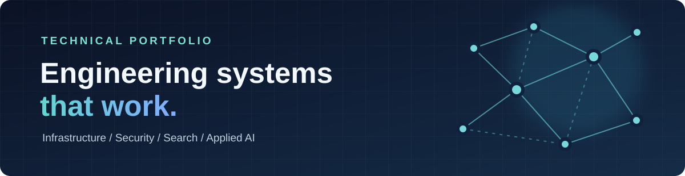
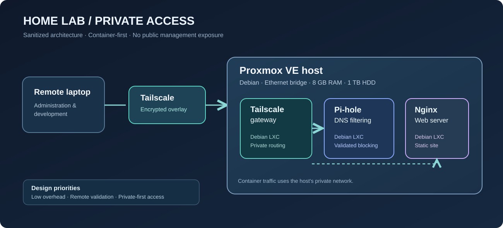

  

  <strong>Computer Science • Linux & Infrastructure • Security Research • Information Retrieval</strong>

  
  
  
  
  

# Hi, I'm Andy. 👋

I build and study systems across **Linux infrastructure, networking, security, search, and applied machine learning**. I enjoy taking projects from a concept to a working, testable implementation—and documenting the trade-offs along the way.

This portfolio highlights selected hands-on work. It is **a documentation repository**, not a claim that every research prototype is production-ready.

## Featured work

| Project | What I built or explored | Stack | Details |
|:--|:--|:--|:--|
| 🖥️ **Proxmox Home Lab** | Repurposed a low-resource desktop into a container-focused lab with private remote access, DNS filtering, and a web server. | Proxmox VE, Debian, LXC, Tailscale, Pi-hole, Nginx | [Explore →](projects/homelab.md) |
| 🔎 **Tor / I2P Link Discovery Research** | Built crawling and data-processing workflows for discovering and analyzing links across privacy networks. | Python, Selenium, Tor, I2P, PostgreSQL | [Explore →](projects/tor-i2p-research.md) |
| 📚 **Information Retrieval & Search** | Implemented search concepts including indexing, ranking, and document features; explored classification approaches. | Python, TF-IDF, PageRank, inverted index | [Explore →](projects/information-retrieval.md) |
| 🤖 **Local LLM & Retrieval Experiments** | Explored local inference and database-backed processing for description aggregation and analysis. | Ollama, Python, PostgreSQL | [Explore →](projects/local-llm-experiments.md) |
| 🌐 **Web Development** | Built and iterated responsive front-end layouts; hosted a development site in the home lab. | HTML, CSS, JavaScript, Nginx | [Explore →](projects/web-development.md) |
| 🛡️ **Security Labs & Competition** | Applied threat-modeling and application security techniques; participated in a technical security competition. | STRIDE, web security, Linux | [Explore →](projects/security-labs.md) |

## Home lab at a glance

  

**Why I designed it this way:** the server has only 8 GB of physical RAM, so lightweight Linux containers were a practical way to operate multiple services while leaving room to experiment. I chose **private remote access first**, instead of exposing management services directly to the public internet.

[Read the architecture and implementation notes](projects/homelab.md) · [Step-by-step build guide](docs/homelab/README.md)

## What I prioritize

- **Build and verify:** use repeatable tests to confirm a service works, rather than assuming that a successful install means the system is healthy.
- **Design around constraints:** be deliberate about memory, storage, network topology, and failure modes.
- **Security-conscious documentation:** explain architecture without publishing credentials, machine-specific identifiers, or sensitive research datasets.
- **Continuous improvement:** document the current state and clearly distinguish it from planned features.

## Next improvements

- Add redacted screenshots and command-output examples from verified deployments.
- Add reproducible setup notes, configuration samples, and test cases where safe to share.
- Expand project write-ups with measured outcomes and lessons learned.
- Add a CI check for documentation links and Markdown formatting.

---

**Connect:** [GitHub](https://github.com/andymunoz92/technical-portfolio) · [LinkedIn](https://www.linkedin.com/in/andymunoz01/) · [Email](mailto:andyamunoz92@icloud.com)
