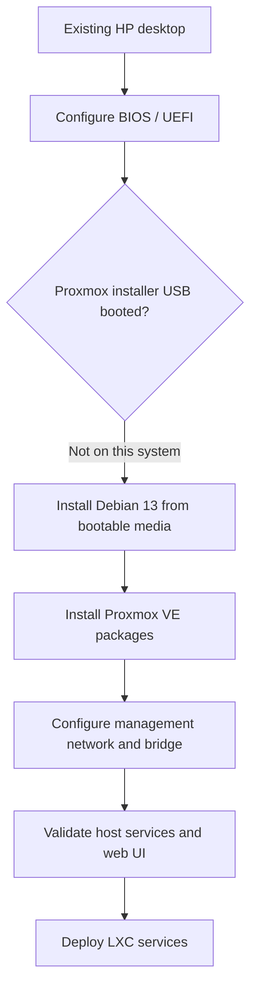

# 01 — From an older desktop to a Proxmox virtualization host

[← Homelab guide](README.md) · [Next: Linux networking →](02-networking.md)

> **Project status:** Operational home lab. This chapter records the decisions and results observed during the build, with additional educational explanations and read-only verification commands. It is not a verbatim installation terminal history.
>
> **Safety / privacy:** This public account excludes internal IP addresses, private keys, credentials, device serial numbers, and identifiable network screenshots. Commands below are for observation; they are not evidence that every command was run during the original installation.

## 1. Problem and constraints

I wanted to learn Linux administration, virtualization, networking, and cybersecurity by building a 24/7 home lab from hardware I already owned, rather than buying a dedicated server. The system was originally a general-purpose desktop and had limited RAM, so I needed to prioritize lightweight services and stable remote administration.

| Component | My lab |
|---|---|
| Hardware | HP Pavilion 550-127c desktop |
| Processor | AMD A10-7800 |
| Memory | 8 GB installed (approximately 6.95 GiB usable reported during testing) |
| Storage | 1 TB hard disk drive |
| OS foundation | Debian 13 (Trixie) |
| Virtualization platform | Proxmox VE 9.2 |
| Firmware approach | UEFI boot; CPU virtualization enabled; Secure Boot disabled for this build |
| Network | Wired Ethernet; Linux bridge `vmbr0` |

**Design decision:** Use Proxmox for centralized administration, and prefer Debian LXC containers for low-overhead services. KVM virtual machines remain available when a separate guest kernel or stronger isolation is needed.

## 2. Architecture at a glance



This is the actual *decision path*, not a complete command transcript.

## 3. What I did, in order

### Step A — Inspect hardware and firmware

Before replacing the original operating system, I identified the host hardware, checked boot settings, and enabled CPU virtualization in firmware. On an AMD platform, this setting is commonly called **AMD-V** or **SVM**.

**Why it matters:** Firmware runs before the operating system and chooses how the machine boots. UEFI and legacy BIOS modes can behave differently with USB installation media. Hardware-assisted virtualization is important for running KVM virtual machines; LXC containers instead share the host's Linux kernel.

**Verified in my build:** UEFI was used, virtualization was enabled, and Secure Boot was disabled. Secure Boot being disabled reflects this build's configuration; it is not a blanket requirement for every Proxmox installation.

### Step B — Diagnose boot media rather than assume Proxmox was broken

My initial attempt to boot the dedicated Proxmox installer from USB failed to appear or boot correctly in the host's UEFI boot selection. The USB/media creation process and older firmware were relevant troubleshooting possibilities. This was a **local boot-path issue**, not evidence that Proxmox itself could not run on the hardware.

**Troubleshooting reasoning:**

1. Determine whether the firmware recognizes the USB device at all.
2. Check whether the USB was created in a boot mode compatible with the target system.
3. Try an independently bootable installer to isolate the problem.
4. Only after successful OS boot, investigate drivers or Proxmox package installation.

I moved to a Debian 13 installer that booted successfully.

### Step C — Install Debian 13 first

I installed **Debian 13 (Trixie)** as the base operating system. Debian supplies the Linux kernel environment, system utilities, service manager, package manager, and filesystem foundation on which the Proxmox platform runs.

**Why this route worked for this project:** Debian installation let me establish a bootable, working Linux host despite the initial Proxmox USB issue. It also required additional manual networking and repository work compared with the standard Proxmox ISO workflow.

> **Reproduction note:** The exact commands, package repository files, disk partitioning choices, and intermediate installer screens were not preserved. I have not reconstructed them as if they were the original commands. For a fresh installation, follow the official Proxmox *Install on Debian 13* instructions for your release, rather than copying a guessed sequence from this portfolio.

### Step D — Add Proxmox VE 9.2 packages

After Debian was operational, I installed Proxmox VE through its Debian package installation route and rebooted into the Proxmox kernel. Proxmox extends the Debian host with a virtualization management stack, including **KVM**, **LXC**, storage management, software-defined networking, an API, and a web interface.

**Important distinction:** Installing Proxmox *on top of Debian* is not the same as running Proxmox *inside a Debian virtual machine*. In my lab, Proxmox operates directly on the physical host.

### Step E — Configure management networking

I used a **wired Ethernet NIC (`eno1`)** and a **Linux bridge (`vmbr0`)** with a stable private management address and default gateway. The bridge connects the host and container interfaces to the physical network. The host Wi-Fi was later disabled/removed because the server would remain connected by Ethernet.

Full networking rationale, layer-2 bridging, IP addressing, routing, and container connectivity are covered in [Chapter 2](02-networking.md).

### Step F — Validate the host before adding services

I confirmed that the Proxmox management services were running and that the web UI could be reached via HTTPS on **TCP port 8006** from an authorized network. The completed host became the base for three Debian LXC services: a Tailscale gateway, a Pi-hole DNS resolver, and an Nginx web server.

**Observed result:** I later accessed the Proxmox web interface remotely over Tailscale from a separate Wi-Fi network. That is stronger evidence than only verifying the page on the home LAN, although remote access controls still need ongoing review.

## 4. Concepts I needed to understand

| Concept | Plain-language explanation | Where it appeared |
|---|---|---|
| BIOS / UEFI | Firmware initializes hardware and selects the boot path before Linux starts. | Boot media troubleshooting |
| AMD-V / SVM | CPU support for hardware-assisted virtualization. | Host firmware preparation for KVM |
| Debian | Linux operating-system distribution providing package management and base services. | Host OS foundation |
| Proxmox VE | Debian-based virtualization platform with management tools for VMs, containers, networking, and storage. | Host management layer |
| KVM | Kernel-based hypervisor technology for running VMs with their own guest kernels. | Available VM capability |
| LXC | OS-level isolation for Linux userspace processes sharing the host kernel. | Lightweight service containers |
| Linux bridge | Software layer-2 switch that connects virtual interfaces and the physical NIC. | `vmbr0` |
| `systemd` | Linux service manager used to start, stop, and observe daemons. | Proxmox management-service checks |
| APT | Debian package-management frontend. | Proxmox package installation and updates |
| Port 8006 | Default TCP port of the Proxmox HTTPS management UI. | Browser access to management console |

### Why LXC instead of full VMs for every service?

The primary constraint was **8 GB of RAM**. A KVM VM normally runs a separate operating-system kernel and its own memory footprint, while an LXC container shares the host's Linux kernel. Containers are therefore an efficient fit for small Linux services such as DNS filtering and static web hosting. This is a **resource-efficiency choice**, not a claim that containers offer identical security isolation to VMs.

## 5. Read-only validation commands

These are examples of safe inspections to run **on the Proxmox host**, not a reconstructed log of the original installation. Some commands may require administrative access.

```bash
pveversion -v                      # Installed Proxmox component versions
uname -r                           # Kernel currently running
hostnamectl                        # Host OS, kernel, and hostname
lscpu                              # CPU, architecture, virtualization information
free -h                            # Current RAM and swap usage
lsblk -o NAME,SIZE,FSTYPE,MOUNTPOINTS  # Storage devices and mounts
ip -br addr                        # Interfaces and addresses (redact before sharing)
ip route                            # Routing table (redact private network details)
systemctl is-active pveproxy pvedaemon  # Proxmox management services
ss -lnt | grep ':8006'             # Check whether a process listens on port 8006
pct list                            # Containers configured on this host
```

**What each check proves:**

- `pveversion -v` and `uname -r` distinguish installed platform packages from the *running* kernel.
- `systemctl` confirms whether service managers report the key daemons as active; a separate browser test confirms end-to-end reachability.
- `ip -br addr` and `ip route` expose local addressing and routing, not whether DNS or a web application works correctly.
- `pct list` shows that Proxmox knows about configured LXC containers; it does not by itself prove that an application inside one is healthy.

Do not publish raw command outputs without reviewing IP addresses, serial numbers, usernames, tokens, or other identifying information.

## 6. Verification evidence to capture (not yet included)

Screenshots are useful only when they prove an observed state. Before uploading, remove identifying details and confirm the image matches the text.

- [ ] **Proxmox Summary:** node and software version, with host-specific details obscured.
- [ ] **Hardware and resources:** CPU, RAM, and storage from the dashboard or read-only terminal output.
- [ ] **Network view:** `eno1` bridged through `vmbr0`, using redacted addresses.
- [ ] **Container list:** the deployed service containers, with any private details hidden.
- [ ] **Validation:** an annotated explanation of a successful login from an authorized remote network (without disclosing Tailscale credentials or device identifiers).

Place approved screenshots in `assets/homelab/` at the repository root, then link them using the relative path `../../assets/homelab/<filename>`.

## 7. Troubleshooting lesson and interview-ready account

**Challenge:** The Proxmox installation USB did not boot as expected on older desktop hardware.

**Approach:** I treated boot detection as a firmware and installer-media problem, validated a working Debian 13 boot path, installed Proxmox as Debian packages, configured networking, and then verified management-service operation and web access.

**Result:** The same machine became an operational virtualization host capable of running independent Debian LXC services. The installation reinforced the value of isolating failures by layer before changing unrelated components.

**In an interview:**

> "I repurposed an HP desktop with 8 GB of RAM as a Proxmox server. The initial Proxmox USB installer had a UEFI boot issue, so I switched to a working Debian 13 installer and installed Proxmox through its supported Debian package path. Once I had the host running, I verified its kernel, management services, and web interface before deploying containers. I chose LXC for the smaller Linux services because I needed to conserve memory, while preserving the ability to run KVM VMs when appropriate."

## 8. Limitations and next improvements

- This is a **single-host learning environment**, not a high-availability cluster.
- The host uses an older HDD and limited RAM; these constrain storage performance and concurrency.
- Backups, recovery drills, patch automation, monitoring, and more rigorous segmentation are areas for further development; this chapter does not claim those are already complete.
- Original installation screenshots and exact shell history were not retained. Later verification commands and configuration evidence should be labeled with their actual capture dates.

## 9. Questions I should be able to answer

1. What happens between powering on a PC and the Linux kernel starting?
2. Why does AMD-V matter for KVM, and why is LXC different?
3. What is the difference between Debian and Proxmox VE?
4. Why might a USB installer fail in UEFI mode?
5. What is different about installing Proxmox on Debian instead of using the Proxmox ISO?
6. Why did I choose LXC containers given the host's RAM constraint?
7. What does `vmbr0` do, and how is it related to `eno1`?
8. How would I diagnose a Proxmox web UI that doesn't load?
9. What evidence would prove that remote administration works securely?
10. What would I improve before operating a production system?

## References

- [Official Proxmox VE installation documentation](https://github.com/proxmox/pve-docs/blob/master/pve-installation.adoc)
- [Proxmox VE Getting Started](https://www.proxmox.com/en/products/proxmox-virtual-environment/get-started)
- [Official Proxmox VE documentation index](https://pve.proxmox.com/pve-docs/)

[← Homelab guide](README.md) · [Next: Linux networking →](02-networking.md)
