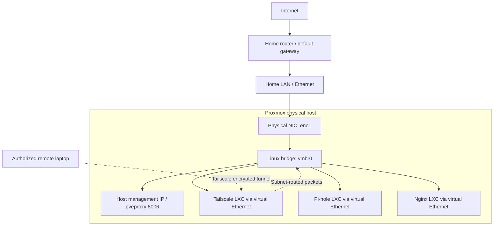
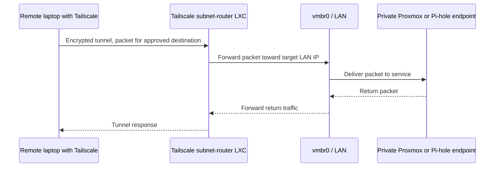

# 02 — Networking my Proxmox home lab: Ethernet, bridges, routing and remote access

[← Homelab guide](README.md) · [← Chapter 1: Installation](01-host-installation.md) · [Next: LXC and resource allocation →](03-containers-resources.md)

> **Project status:** Operating home lab, based on the configuration and tests documented during the build. Commands and illustrative configuration below explain how the system works; they are **not** an unaltered terminal history. Sensitive addresses, device identifiers and access details are intentionally omitted from the public version.
>
> **Operational precaution:** Do not change host networking on an unattended, remotely administered machine without console access and a rollback plan. A bad bridge/gateway edit can disconnect Proxmox and all its containers.

## 1. The problem I needed to solve

I repurposed an older HP desktop into a 24/7 Proxmox host, using just **one physical wired network connection**. I needed each service to have a stable network identity, while keeping management access private:

- Proxmox management web UI on the host (HTTPS/TCP 8006)
- Tailscale subnet-router container for authorized remote access
- Pi-hole container for DNS filtering
- Nginx container for serving a development website

I chose a **Linux bridge** rather than separate network adapters or a NAT-only guest network. The bridge allows each LXC container to participate on the home LAN as its own device, using an independent MAC and IP address. The Proxmox host itself has its management IP on that bridge.

## 2. Network topology: what connects to what



**Read this diagram carefully:**

1. A physical Ethernet cable connects the host's `eno1` interface to the home network.
2. `vmbr0` is a software Layer 2 switch that connects `eno1` to the host and each container's virtual Ethernet endpoint.
3. Each container has a virtual NIC in the same LAN subnet, so the home router can reach it as a separate device.
4. When a remote laptop accesses a LAN service via Tailscale, traffic can enter via the **Tailscale container's tunnel interface**, be routed through that container, and then cross the LAN to the target.

A **bridge** is not the same as a **router**: the bridge forwards Ethernet frames based on MAC addresses; a router forwards IP packets between IP networks. The Tailscale container can act as a router while `vmbr0` remains a bridge.

## 3. Naming and roles of the interfaces

| Item | Role | OSI-oriented view |
|---|---|---|
| `eno1` | Physical Ethernet NIC, attached to the switch/router | Layer 1/2 |
| `vmbr0` | Software bridge carrying host and container traffic | Layer 2; host IP configured on bridge |
| Host `veth` endpoint | Virtual cable endpoint connecting each LXC container to `vmbr0` | Layer 2 |
| Container `eth0` | Guest-facing network interface inside an LXC | Layer 2/3 |
| `tailscale0` (inside the gateway CT) | Encrypted overlay-network interface | Layer 3 overlay |
| Gateway/router | Route to destinations beyond the LAN | Layer 3 |
| DNS server | Resolves names and enforces DNS filtering | Application-layer service, usually UDP/TCP 53 |

**Why put the management IP on `vmbr0` rather than `eno1`?** In a normal Proxmox bridged setup, `eno1` is a bridge port configured without its own management IP, and `vmbr0` owns that IP. Proxmox can then connect the host and guests to the same virtual switch.

## 4. IP address, subnet mask, gateway and DNS: separate jobs

- **IP address:** identifies a network interface for IP communication.
- **Subnet prefix:** defines the local network; `/24` commonly means `255.255.255.0`. For the illustrative `192.0.2.0/24` network, `192.0.2.1` and `192.0.2.20` are on the same local subnet.
- **`/32` route:** targets exactly one IPv4 address. I used individual host routes in Tailscale instead of automatically advertising the whole LAN.
- **Default gateway:** where a device sends packets when no more-specific route matches; for example, traffic destined for a public Internet IP.
- **DNS server:** maps names such as `example.org` to addresses. Correct DNS is not a substitute for correct routing.
- **MAC address:** a link-layer address used by switches/bridges to forward frames on the local link.

> The `192.0.2.0/24` addresses on this page are **reserved documentation examples**, not addresses copied from the running home network. Do not paste them into a live network configuration.

### What happens when a container opens a website?

1. The application requests a DNS lookup (unless it already knows an IP address).
2. The container sends the lookup to its configured DNS resolver (in my lab, the Pi-hole service is used by some containers).
3. The container sees that the resolved public IP is **outside** the LAN prefix and sends the packet to its default gateway.
4. Ethernet frames travel through the container's virtual NIC, `vmbr0`, `eno1`, and the home router.
5. Replies return along the network path. The browser or command-line client then speaks HTTP/HTTPS to the destination.

**Important:** A container's `/etc/resolv.conf` controls DNS resolver settings, not its IP address or routing table. `ping 1.1.1.1` working while `getent hosts debian.org` fails suggests DNS trouble, but is not conclusive without checking DNS responses and filtering.

## 5. Why I used stable addresses

Stable service addresses make SSH aliases, DNS configuration, bookmarked management URLs and troubleshooting more predictable. In the real build, I used a **static management address** on the Proxmox bridge and established stable LAN addresses for the service containers. I also configured reservations on the home router for selected container addresses.

A **DHCP reservation** is configured on the DHCP server to allocate a known lease to a specific device. A **statically configured IP** is set inside the host or guest OS. A reservation does not force an OS with a statically configured address to use DHCP. I must coordinate both to avoid duplicate-address conflicts.

### Illustrative host bridge configuration — do not apply as-is

```ini
# EXAMPLE ONLY: documentation addresses, not my host configuration
iface eno1 inet manual

auto vmbr0
iface vmbr0 inet static
    address 192.0.2.10/24
    gateway 192.0.2.1
    bridge-ports eno1
    bridge-stp off
    bridge-fd 0
```

- `iface eno1 inet manual`: do not configure a separate IP address on the physical bridge port.
- `address`: static IPv4 address assigned to the bridge.
- `gateway`: default next hop for traffic beyond the local subnet.
- `bridge-ports eno1`: include the physical NIC in the virtual switch.
- `bridge-stp off`: disables Spanning Tree Protocol in this simple topology (not universally appropriate for larger networks with loops).
- `bridge-fd 0`: bridge forwarding delay setting in this example.

This snippet is illustrative. The running configuration should be inspected with read-only commands and maintained through Proxmox's network management tools.

## 6. Remote access: why Tailscale needs routes

On the home LAN, my laptop can reach the host and containers directly, subject to normal LAN routing and firewall rules. Away from home, the laptop is **not on the same subnet**. I use Tailscale on the laptop and a **Tailscale-enabled LXC subnet router** to provide an authorized path to selected home-LAN addresses.



Tailscale subnet-routing success requires **more than installing the client**:

1. The gateway container must be running Tailscale and able to reach the local network.
2. IP forwarding must be enabled in the container to route packets between interfaces.
3. The subnet router must **advertise routes**, such as selected `/32` host routes.
4. Those routes must be **approved** in the tailnet admin console (or automatically via policy).
5. The remote device must **accept/use the routes**, and the tailnet access-control policy must allow the traffic.
6. The destination service must be listening, and firewalls must allow the connection.

The Tailscale IP of the subnet-router container is **not** the same as the IP of a Pi-hole or Proxmox service on the LAN. A Tailscale tunnel makes a route possible; it does not inherently make every service accessible.

**Verified in the project:** I tested remote Proxmox web management from a different Wi-Fi network, and I tested Pi-hole DNS filtering locally and through the Tailscale path. Remote access to the Nginx container requires its own validation; I do not count it as verified solely because Proxmox is reachable.

**Security choice:** I did not need to expose the Proxmox management port directly to the public Internet. Tailscale provides a controlled private route, supplemented by normal service authentication and access rules.

## 7. Read-only validation: inspect each layer

Run these on the **Proxmox host** over SSH or via the console:

```bash
ip -br link                          # Link state and interface names
ip -br addr                          # Addresses; REDACT before publishing
ip route                             # Local and default routes
bridge link                          # Bridge members and port state
cat /etc/network/interfaces          # Host network configuration; redact
ip address show dev vmbr0            # Host bridge interface details
pct list                             # Check whether expected LXCs exist/run
```

Run these **inside a container**, via its Proxmox console or `pct exec` from the host:

```bash
ip -br addr                          # Container interface address
ip route                             # Container default gateway
getent hosts debian.org              # Resolver lookup
ping -c 2 1.1.1.1                    # Test numeric IP reachability; ICMP may be blocked
```

Run these **inside the Tailscale gateway container**:

```bash
tailscale status                      # Tailnet devices (sanitize output)
tailscale ip -4                       # This container's overlay IPv4 address
sysctl net.ipv4.ip_forward           # Should be 1 for IPv4 subnet forwarding
```

Run these from an **authorized laptop** (substitute a verified destination):

```bash
# On the home LAN or over a working Tailscale subnet route:
# curl -kI https://<proxmox-private-ip>:8006/
# SSH reachability: nc -vz <webserver-private-ip> 22
# DNS test: nslookup example.org <pihole-private-ip>
```

`curl -k` is suitable for a *temporary diagnostic* against a self-signed certificate, not as a recommendation to disable TLS validation in normal applications. Always compare successful TCP connectivity with authentication and actual application behavior.

## 8. Troubleshooting method: from physical link to application

| Symptom | Hypothesis to test | Read-only checks |
|---|---|---|
| Host unreachable even on LAN | Physical link or bridge misconfiguration | NIC LEDs, `ip -br link`, `bridge link` (local console if needed) |
| Host reaches LAN, not Internet | Wrong/missing default route | `ip route`, gateway test |
| IP connectivity works, hostname doesn't | DNS resolver or filtering issue | `cat /etc/resolv.conf`, `getent hosts`, `nslookup`/`dig` |
| Remote laptop can't reach one private IP | Missing `/32` route advertisement, approval, client route, or ACL | Tailscale gateway settings, admin route approvals, client route table |
| Ping succeeds but website fails | TCP port, service binding, firewall, TLS, or app failure | `ss -lnt`, `curl -I` / `curl -kI` |
| Terminal SSH works but VS Code Remote-SSH fails | Client-specific host entry, selected SSH binary, plugin, proxy, or remote installation | `ssh -v`, VS Code Remote-SSH log, compare destinations |

**Troubleshooting lesson from this project:** Terminal SSH and VS Code Remote-SSH did not initially behave identically. That is a reminder to compare the *exact client, hostname, network path and logged error* instead of assuming the server is offline. The cause should not be asserted without logs showing it.

A useful sequence is: **physical link → bridge → IP address → routing → DNS → port/service → authentication → application**. Do not stop at `ping`: it checks only a portion of the path.

## 9. Security and limitations

- Private management over Tailscale is preferable to unnecessary public port forwarding, but access rules and service authentication remain important.
- Keep host and container software updated. Separate containers help manage failure domains but **share the host kernel** and are not equivalent to full VM isolation.
- A flat home LAN does **not** provide VLAN isolation. VLANs and firewall segmentation remain possible future improvements.
- A single Ethernet link, one router, and one physical Proxmox host are single points of failure. This is a learning lab, not a production HA cluster.
- Never publish Tailscale authentication keys, SSH keys, credentials, private DNS records, router administration pages or raw logs containing personal data.
- Avoid applying live network configuration changes remotely without a rollback method.

## 10. Evidence to add to this chapter

- [ ] Redacted Proxmox **Node → System → Network** screenshot showing `eno1` and `vmbr0` relationship.
- [ ] Redacted `ip -br addr` and `bridge link` output (taken on the same date).
- [ ] Screenshot of LXC network settings with IPs and MACs obscured.
- [ ] Annotated remote management test, with the Tailscale account and device identifiers hidden.
- [ ] DNS filtering demonstration (`example.org` resolution and one test domain blocked by Pi-hole), excluding internal query histories.
- [ ] A short issue log describing one real troubleshooting case, its evidence, and final resolution.

## 11. Interview-ready summary

> “My Proxmox host uses a single wired network adapter, `eno1`, connected to a Linux bridge called `vmbr0`. The bridge functions like a software switch and lets the host and each LXC service have its own LAN address. I used stable IP assignments to simplify administration, Tailscale subnet routing for private access from outside the home, and Pi-hole for DNS filtering. I validated connectivity by checking the link, bridge, route table, name resolution and application ports separately. One lesson was that successful SSH from a terminal didn't guarantee that VS Code Remote-SSH would use the same connection path, so client-specific logs mattered.”

## 12. What I should be able to explain

1. What is the difference between a physical NIC, a Linux bridge, a router, and a virtual NIC?
2. Why does the Proxmox management IP belong on `vmbr0` in this design?
3. How do a MAC address, IPv4 address and default gateway differ?
4. What is the difference between `/24` and `/32`?
5. What is the difference between static IP configuration and a DHCP reservation?
6. Why can `ping 1.1.1.1` work while `getent hosts debian.org` fails?
7. Why is Tailscale subnet-routing different from giving each service its own Tailscale client?
8. What must be configured on the subnet router, tailnet admin console and remote laptop?
9. How would I investigate “No route to host” before blaming Nginx or SSH?
10. How would I make this topology more resilient and better segmented for production?

## References

- [Proxmox VE networking documentation](https://github.com/proxmox/pve-docs/blob/master/pve-network.adoc)
- [Tailscale subnet routers](https://tailscale.com/docs/features/subnet-routers)
- [Tailscale route injection and permissions](https://tailscale.com/docs/reference/route-injection)
- [Pi-hole documentation](https://docs.pi-hole.net/)

[← Homelab guide](README.md) · [← Chapter 1: Installation](01-host-installation.md) · [Next: LXC and resource allocation →](03-containers-resources.md)
