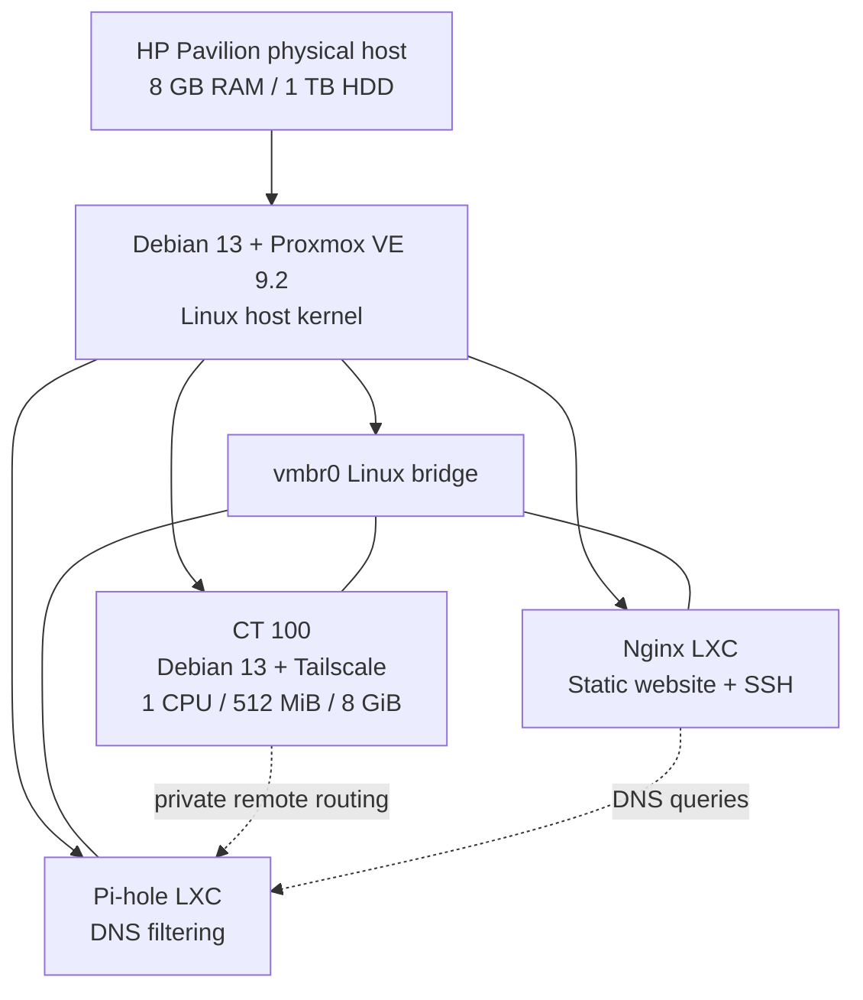

# 03 — LXC Containers and Resource Management

[← Home lab guide](README.md) · [← Networking](02-networking.md) · [Next: Tailscale →](04-tailscale.md)

> **Project context:** Proxmox VE 9.2 on a repurposed HP Pavilion 550-127c, AMD A10-7800, 8 GB physical RAM, and a 1 TB HDD. The host runs Debian-based LXC containers for Tailscale, Pi-hole, and Nginx. This is a **learning lab**, not a claim of production availability.
>
>
> **Evidence labels:** **Verified** = observed in the build. **Documented decision** = architectural choice. **Example** = teaching/demo material, not necessarily a command executed on the host. **To verify** = needs a live configuration check.

## 1. The design problem

I wanted to run several independent services on hardware with limited RAM and a single mechanical HDD. If I created a full virtual machine for every service, each VM would run its own guest kernel and operating system. That is useful for stronger isolation or a non-Linux guest, but would consume additional resources for my small Debian-based services.

**Documented decision:** I chose Proxmox-managed **LXC system containers**: independent Linux user spaces that share the Proxmox host's Linux kernel. I can administer each container with its own users, network stack, packages, and systemd services while avoiding a separate guest kernel per service.

**Trade-off:** Sharing the kernel increases the importance of host patching and container restrictions. A container is **not** a security equivalent of a virtual machine.

## 2. LXC compared with KVM and Docker

| Category | Proxmox LXC system container | KVM/QEMU virtual machine | Docker/OCI application container |
|---|---|---|---|
| Kernel | Shares host Linux kernel | Guest runs its own kernel | Typically shares its Linux host kernel |
| Intended unit | Linux system environment with multiple services | Complete operating system | Packaged application and dependencies |
| OS support | Linux user spaces compatible with host kernel | Windows, Linux, and other supported guests | Depends on host/VM and image |
| Typical overhead | Low | Greater baseline resource use | Often low |
| Isolation | Namespaces, cgroups, security policy, user mappings | Virtual hardware and kernel boundary | Namespaces, cgroups, runtime security |
| My project | Tailscale, Pi-hole, Nginx each in an LXC | Not required for these services | Future experiment, not my initial deployment |

**Important:** LXC is a container technology, while Proxmox is the management platform. Docker is not a substitute for Proxmox as a whole. Modern Proxmox documentation also discusses OCI image support as a technology preview; that does **not** change how the existing Debian LXC services in this lab were built.

## 3. Architecture and failure boundaries



**Verified:**

- **CT 100** is an unprivileged Debian 13 LXC running Tailscale, configured with **1 CPU, 512 MiB memory, and 8 GiB disk**, with start-at-boot enabled. A TUN device was exposed for the VPN interface.
- Pi-hole runs in its own Debian 13 LXC; DNS resolution and blocking were tested.
- Nginx runs in a separate Debian 13 LXC; an HTTP page and SSH terminal access were tested.
- Remote Proxmox administration through the Tailscale path worked from an outside Wi-Fi network.

**To verify before listing exact numbers:** Pi-hole and Nginx CT IDs, CPU limits, memory/swap ceilings, and disk sizes. Do not infer these from the Tailscale container.

**Why separate containers?** A web-server package change should not require changing Pi-hole's packages, and troubleshooting DNS should not force a reboot of the Tailscale environment. A crashed application can remain scoped to its own container. This is **organizational and process isolation**, not immunity to a shared host failure. All three containers depend on the single Proxmox host, kernel, disk, and network.

## 4. Technical foundations

### Linux namespaces: *what a process can see*

Namespaces provide distinct views of kernel resources. Relevant examples include:

- **PID namespace:** a container sees its own process tree.
- **Network namespace:** its own interfaces, IP addresses, and routes; the `veth` interface can connect to `vmbr0`.
- **Mount namespace:** its own filesystem mount view.
- **User namespace:** container UIDs/GIDs can map to different, less-privileged host IDs.
- **UTS namespace:** independent hostname.

**Interview summary:** namespaces provide separation of views and identities; they do not allocate memory or CPU by themselves.

### Control groups (cgroups): *how many resources processes may consume*

The kernel's cgroup controllers account for and constrain processes, including memory and CPU. Proxmox exposes many of these settings in its **Resources** view and `pct` configuration.

- **`memory`**: memory ceiling for container processes, not memory permanently reserved from the host.
- **`swap`**: additional swap allowance; actual availability depends on host configuration and pressure.
- **`cores` / `cpulimit`**: controls CPU access or bandwidth. A core setting is not a dedicated physical CPU permanently owned by that container.
- **`cpuunits`**: relative scheduling weight under contention, not a guaranteed share at every instant.
- **`rootfs`**: virtual disk/root filesystem storage configured through Proxmox storage.

A guest can show little actual memory use despite having a higher configured limit. Conversely, giving multiple containers generous ceilings does not manufacture more host RAM: all workloads compete for physical memory.

### Unprivileged vs privileged LXC

**Unprivileged LXC** maps the apparent `root` user inside the container to an unprivileged identity on the host using user namespaces. This is the safer default for many services. **Privileged LXC** has a larger potential impact on the host when compromised and should be avoided unless there is a compelling, understood reason.

My Tailscale gateway is **verified unprivileged**. The privilege mode of the Pi-hole and Nginx containers needs a read-only configuration check before publishing a claim about them.

### Why Tailscale needed special permissions

Tailscale normally uses a **TUN** device to represent an IP tunnel. The Debian LXC was configured with access to `/dev/net/tun`; it also used nesting-related settings. Passing a host device into a guest increases capability and should be intentional and limited. **Nesting does not mean the container is a full VM, nor does it automatically make Docker-in-LXC the best design.**

## 5. How I provisioned services — GUI workflow

**Reproducible example; not a complete transcript of the original clicks.** The sequence below documents the workflow used conceptually for a new service:

1. Download a supported Debian container template into a Proxmox storage location.
2. Select **Create CT**, choose a unique **CT ID** and hostname.
3. Prefer **Unprivileged container** unless the application requirements justify otherwise.
4. Choose root disk, CPU, memory and swap settings based on measured host headroom.
5. Attach the container's `net0` virtual NIC to **`vmbr0`**, and assign or reserve an address according to the LAN plan.
6. Review DNS settings and start-at-boot behavior.
7. Start the container, update packages, and install **only** its intended service.
8. Verify service health, local connectivity, and dependencies before considering it deployed.
9. Document exact allocations and keep credentials and access tokens out of public screenshots and repositories.

For the Tailscale gateway, enabling TUN access was a deliberate additional step, not an automatic feature for all containers.

## 6. Inspect the real host without changing it

Run these commands in the **Proxmox host shell**, not inside a container. All commands below are read-only:

```bash
pct list                       # Show CT IDs, names and running state
pct status 100                 # Status of Tailscale CT 100
pct config 100                 # Configured memory, cores, rootfs, network, flags
pct exec 100 -- hostname       # Execute a harmless command inside CT 100
pct exec 100 -- systemctl is-active tailscaled
free -h                        # Current host RAM and swap observations
pvesm status                   # Configured storage pools and usage
```

Review `pct config <CTID>` for each of your other containers **privately** before copying outputs into a public issue or README. Configuration may contain network identifiers, host mount paths, or other environment-specific metadata.

Inside the specific container, useful checks include:

```bash
systemctl --failed
systemctl status nginx --no-pager      # In the webserver CT only
systemctl status pihole-FTL --no-pager # In the Pi-hole CT only
ip -brief address
ss -lntup
```

The commands that inspect Nginx or Pi-hole must be run in the **relevant container**, not blindly on the host or CT 100.

## 7. Resource planning on an 8 GB system

A reasonable design needs **measurements**, not only a sum of configured limits. In my environment, the host needs RAM for the Proxmox services, filesystem cache, networking, and kernel processes; each container then consumes some physical memory while active.

| Item | What is documented | How to reason about it |
|---|---|---|
| Physical machine | 8 GB installed | Not all of it is available to guest workloads |
| CT 100 Tailscale | 512 MiB RAM limit, 8 GiB disk | A ceiling, not a promise it always consumes 512 MiB |
| Pi-hole CT | Deployed; limits to verify | Observe actual memory during normal DNS traffic |
| Nginx CT | Deployed; limits to verify | Observe active usage while serving requests |
| Host | Proxmox services and OS | Preserve room for kernel, networking, file cache and bursts |
| Swap | Host swap configured | Helps absorb some memory pressure but can cause severe I/O latency on HDD |

**Illustrative budget only:** if a host had about **7 GiB usable** RAM, a planning spreadsheet could reserve 2 GiB for host operation and headroom, then assign up to 512 MiB as a ceiling for each of three tiny services. That would leave roughly **3.5 GiB of theoretical room** for additional workloads and variability. This is not a live measurement and not permission to fill every remaining byte. Monitor before increasing limits.

### Storage trade-off

A 1 TB HDD has substantial nominal capacity but much poorer random-I/O performance than an SSD. Booting guests, package installations, logging, swapping, and backups can contend for disk access. A disk or host failure affects **all** local services; container isolation does not provide hardware redundancy.

### Backups and snapshots are not the same

- **Snapshot:** a storage-dependent, point-in-time rollback mechanism; available features depend on the storage backend.
- **Backup:** a copy of guest data/configuration made using a supported backup method, ideally stored **off the same physical disk**.
- **Restore test:** verifies that a backup can actually recover a service.

Do not assume that a snapshot exists or is supported on my present storage configuration. A backup stored only on the same HDD does not protect against that drive failing.

## 8. How to troubleshoot container problems

| Symptom | First diagnostic step | Likely layers to inspect |
|---|---|---|
| CT won't start | Check Proxmox task log, `pct status <id>`, resource/storage state | Storage availability, config, mounts, device permissions |
| CT starts but app unavailable | `pct exec <id> -- systemctl --failed` | Service state, logs, listening port |
| CT cannot reach LAN | Check guest IP and host bridge | `veth`, `vmbr0`, subnet, gateway, firewall |
| Container can ping IP, not domain | Query configured DNS resolver directly | Nameserver, Pi-hole service, upstream resolver |
| Host becomes sluggish | `free -h`, guest allocations, CPU/I/O and swap activity | RAM pressure, swap thrashing, HDD bottleneck |
| Guest needs a host device | Inspect the application requirement first | Unprivileged restrictions, precise device mapping, security impact |

**Example investigation:** A DNS lookup fails inside the webserver. First check IP connectivity, then `/etc/resolv.conf`, then whether Pi-hole responds to a direct DNS query, and only then inspect Pi-hole's upstream resolution. Do not conclude that "the Internet is down" from a single failed hostname lookup.

## 9. Security boundaries and planned improvements

- Keep host management services private; do not expose port 8006 to the public Internet just to make the lab reachable.
- Prefer unprivileged containers, minimal features, and narrowly scoped device access.
- Update the host and container packages, keep services isolated, and remove unused packages and credentials.
- Use SSH keys where possible; restrict access to authorized users and networks.
- Record backups and perform restore tests before claiming recoverability.
- **Planned, not yet verified:** systematic backup and restore drills, centralized logging, per-service monitoring, and documented update/rollback procedures.

## 10. Interview-ready explanation

> I repurposed an HP Pavilion with 8 GB RAM into a Debian-based Proxmox host. Because I wanted several Linux services without the overhead of a full guest OS for each one, I chose separate LXC system containers for Tailscale, Pi-hole, and Nginx. The containers share the host kernel but use namespaces for isolation and cgroups for resource controls. I deployed the VPN gateway as an unprivileged LXC with a carefully configured TUN device, and validated DNS, SSH, web hosting, and remote access individually. I also understand the limitations: kernel sharing reduces the isolation boundary compared with VMs, and the single HDD is still a point of failure.

## 11. Evidence to add later

- [ ] Sanitized screenshot of **Datacenter → node → CT list** (hide sensitive names/IPs if necessary)
- [ ] Read-only `pct config 100` output, redacted before publishing
- [ ] Pi-hole and Nginx CT IDs and resource ceilings confirmed
- [ ] Proxmox memory/CPU utilization screenshot with date and workload context
- [ ] Backup location, schedule, and first documented restore test
- [ ] Notes on what changed after adding an additional service

---

### References

- [Proxmox Container Toolkit / `pct` documentation](https://github.com/proxmox/pve-docs/blob/master/pct.adoc)
- [Proxmox LXC configuration options](https://github.com/proxmox/pve-docs/blob/master/generated/pct.conf.5-opts.adoc)
- [Linux kernel: control group v2](https://docs.kernel.org/admin-guide/cgroup-v2.html)
- [Linux manual: namespaces](https://man7.org/linux/man-pages/man7/namespaces.7.html)
