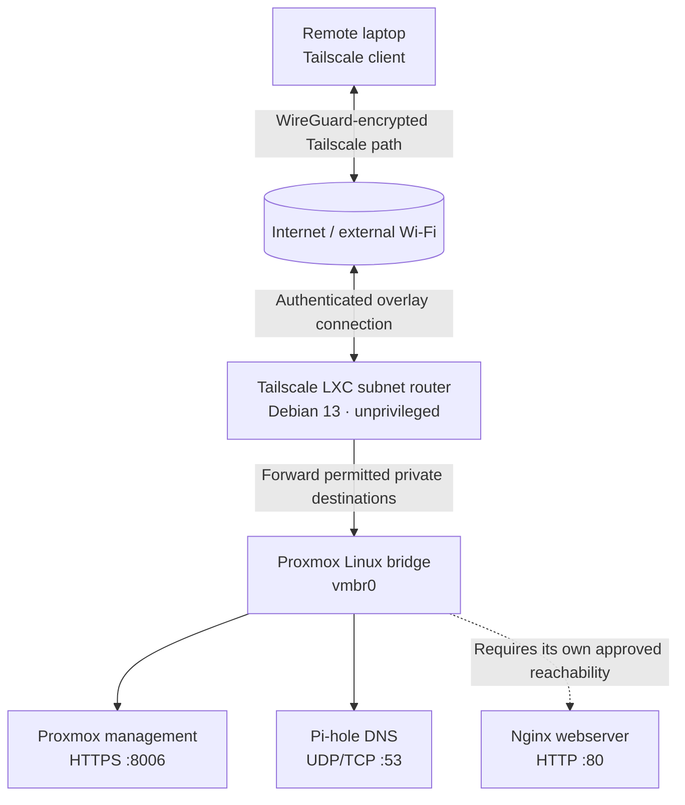
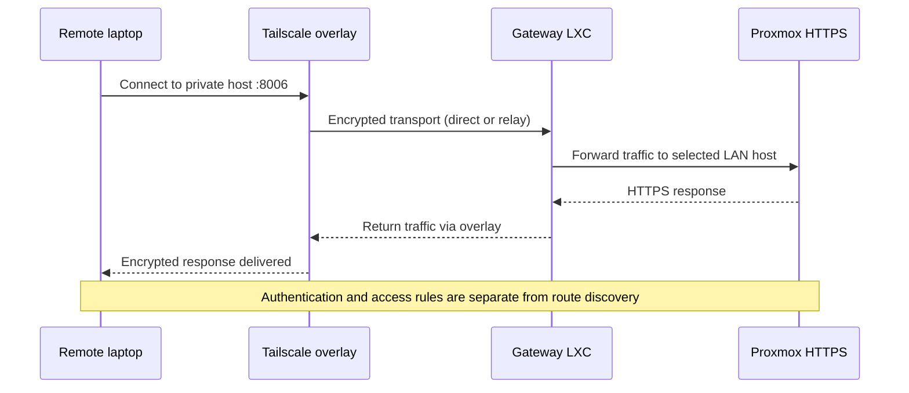

# 04 — Tailscale: Private Remote Access and Subnet Routing

[← Home lab guide](README.md) · [← LXC and resources](03-containers-resources.md) · [Next: Pi-hole →](05-pihole.md)

> **Project scope:** Personal learning lab running Debian 13 and Proxmox VE 9.2 on an 8 GB RAM desktop. This guide documents the architecture, confirmed outcomes, and the reasoning behind the design; it is not a production security assessment.
>
> **Evidence convention:** **Verified** = directly observed during this project; **Documented decision** = a known architecture choice; **Example** = educational command or illustrative network; **To verify** = a live configuration check is still needed.
>
> **Privacy convention:** Public examples use **illustrative** RFC 1918 addressing (`192.168.50.0/24`). They are not the actual lab IPs. Authentication material, tailnet identifiers, and full internal host inventories are intentionally excluded.

## 1. The problem I needed to solve

My Proxmox web UI was reachable from my home network, but I wanted to manage the host when traveling without opening its HTTPS management port to the entire internet. I also wanted to reach selected internal services, such as my DNS-filtering container, without installing Tailscale in every guest.

**Documented decision:** I deployed **Tailscale in a small, unprivileged Debian LXC container** and configured it as a **subnet router**. An authenticated remote laptop joins the same **tailnet** (a private Tailscale network), then reaches explicitly advertised LAN destinations through the gateway container.

**Why not forward port 8006 on the home router?** Public port forwarding would create a direct inbound path to a sensitive management service. A private overlay with authenticated devices and narrowly scoped routes reduces public exposure. It is not a substitute for strong credentials, updates, and access-control rules.

**Verified outcome:** I connected from an external Wi-Fi network and reached the Proxmox web interface through the Tailscale path. I subsequently tested access to Pi-hole DNS from a remote client. The precise status of every possible route, including the webserver, still needs periodic verification.

## 2. The architecture



The diagram shows the **logical path**. Tailscale may establish direct peer-to-peer UDP connectivity or use an end-to-end-encrypted relay if the surrounding networks prevent direct traversal. It is not a claim that all packets necessarily pass through Tailscale-owned servers.

### Confirmed container design

| Component | Known setup | Purpose |
|---|---|---|
| Proxmox host | Debian 13 + Proxmox VE 9.2, wired Ethernet and `vmbr0` | Runs and connects the containers |
| Tailscale gateway | CT 100; unprivileged Debian 13 LXC; 1 CPU setting; 512 MiB RAM limit; 8 GiB root disk; starts on boot | Private overlay gateway and subnet router |
| Container device | `/dev/net/tun` passed through; nesting-related feature enabled | Supports the tunnel device inside the unprivileged LXC |
| Forwarding | IPv4 forwarding enabled | Allows traffic to pass *through* the gateway |
| Route scope | Selected `/32` IPv4 host routes | Avoids advertising the entire LAN as one broad route |
| Remote client | Mac laptop running Tailscale | Administers the host from a separate network |

**Not yet verified in a recent snapshot:** the precise current list of approved routes, ACL/grant policy, subnet-router SNAT settings, and any current route to the Nginx container.

## 3. Concepts behind the setup

### VPN, overlay network, and WireGuard

A **VPN** connects systems through protected logical networking over a less-trusted physical network such as the internet. An **overlay network** supplies virtual addressing and connectivity above the underlying physical network. Tailscale uses **WireGuard** to encrypt traffic between its participants and adds device identity, coordination, routing, and policy management.

The data path and control plane are different:

- **Control plane:** Coordinates device identities, peer information, policies, and other connection metadata.
- **Data plane:** Carries traffic between devices, protected using WireGuard encryption. It usually flows directly between peers when NAT traversal works; otherwise it can be relayed while remaining end-to-end encrypted.

**Interview distinction:** “Tailscale is built on WireGuard” does not mean every device sends its traffic to a central VPN gateway. The overlay typically connects peers, while the **subnet-router container** is specifically the gateway for my *non-Tailscale* LAN targets.

### NAT, firewalls, and relays

Home routers typically use **NAT** to map private addresses to an external address. Firewalls often reject unsolicited inbound connections, particularly on public or hotel Wi-Fi. Tailscale attempts to establish peer connectivity without requiring me to expose Proxmox management with a traditional port-forward rule. If it cannot form a direct UDP connection, it can fall back to an encrypted relay (DERP, or a configured peer relay).

A relay usually changes **latency and throughput**, not whether the WireGuard payload is encrypted.

### Tailnet versus LAN

- **Home LAN:** The physical/local network where the Proxmox host and containers use private IPv4 addresses.
- **Tailnet:** Devices authenticated and authorized in the Tailscale overlay.
- **Subnet router:** A tailnet node that advertises reachability to devices on another IP network. The destinations do *not* have to install Tailscale themselves.
- **Exit node:** An entirely different feature that can route a client's default internet traffic through a selected node. **I did not configure an exit node for this lab.**

### What is `/dev/net/tun`?

A **TUN** device is a virtual **Layer 3** network interface through which software receives and sends IP packets. Running Tailscale normally requires access to such an interface. Unprivileged LXC containers generally do not have the TUN device available by default, so the Proxmox host must explicitly expose it to the guest. This is a narrowly scoped device permission, not a reason to make the whole container privileged.

**Alternative:** Tailscale also has userspace networking mode where access to TUN is unavailable. I used TUN passthrough for this lab, not that alternative.

### What does IPv4 forwarding do?

Normally, a Linux system processes packets addressed to itself. Enabling `net.ipv4.ip_forward=1` allows the kernel to route packets *between* interfaces. In this project, the Tailscale container must receive a packet destined for a LAN host and forward it toward that host. Forwarding by itself does not authorize traffic: routes, network filtering, and tailnet policy still matter.

### Why `/32` instead of `/24`?

In IPv4, a **CIDR prefix** specifies how much of an address is the network portion. For example, on this **illustrative** LAN:

| Route | What it selects |
|---|---|
| `192.168.50.10/32` | One host address |
| `192.168.50.20/32` | One host address |
| `192.168.50.0/24` | The whole 256-address prefix (including addresses reserved for network and broadcast) |
| `0.0.0.0/0` | IPv4 default route, potentially used for an exit-node design |

**Documented decision:** I advertised specific host routes rather than my entire home `/24`. That limits what destinations the subnet router *offers*, though **route approval is not the same as an application firewall or a tailnet ACL**. A security policy must also control *which identities may access which ports*.

### Route advertisement versus approval versus policy

1. **Advertise:** The subnet router announces that it can forward packets to specific prefixes.
2. **Approve:** The Tailscale administrator approves those routes, or policy may auto-approve them.
3. **Authorize:** Tailnet ACLs/grants determine which identities can reach which network resources; target firewalls and application authentication still apply.
4. **Accept/use:** The client must receive/use applicable routes. Specific client behavior can differ by operating system and policy.

Each step can fail independently. A route that appears advertised but is not approved is not enough for access.

### Source NAT (SNAT) and return paths

Subnet routing requires a **return path** from the LAN service back to the remote client. By default, Tailscale subnet routers use **source NAT**, making the forwarded traffic appear to originate from the subnet router's LAN address. This often avoids configuring a return route on the home router. Disabling SNAT can preserve the true source address, but then return routes may need explicit configuration.

**To verify:** I did not capture a recent authenticated snapshot of the gateway's current SNAT option, so the preceding paragraph explains the default, not an audited claim about this installation.

## 4. How I deployed it

This is the **recorded sequence**, not a literal copy of the original terminal history.

1. **Provisioned a Debian 13 LXC** as CT 100 in Proxmox, selecting unprivileged mode and small resource limits suited to the 8 GB host.
2. **Allowed the TUN device** from the host to the container and enabled the necessary container features. I retained unprivileged LXC rather than running the guest as privileged.
3. **Installed Tailscale inside the container** and authenticated the node to my tailnet. No login URLs, keys, or auth tokens are published here.
4. **Enabled IPv4 forwarding** inside the gateway environment and ensured the setting was applied.
5. **Advertised selected `/32` host routes** and approved them through the Tailscale administrative console. I intentionally avoided advertising the entire LAN.
6. **Connected Tailscale on my Mac**, tested access while away from home, and verified that the Proxmox web UI was reachable.
7. **Expanded the route set** to include the DNS-filtering service and checked direct DNS responses remotely. A separate webserver route should not be assumed approved without checking the current policy.

### Proxmox TUN provisioning — illustrative configuration changes

```bash
# Example ONLY: run on the Proxmox host after checking the current CT config.
# These commands CHANGE configuration; do not rerun blindly on a working gateway.
pct set 100 --dev0 /dev/net/tun
pct set 100 --features keyctl=1,nesting=1
```

Modern Proxmox also exposes **Resources → Add → Device Passthrough**. Rebooting/restarting the container may be required for a new device passthrough to take effect. Actual settings already present should be inspected first. Granting TUN access and nesting features increases capability and merits a deliberate security review.

### Route advertisement — illustrative configuration change

```bash
# EXAMPLE ONLY. Replace these with your own explicitly approved destinations.
# Run INSIDE a configured Tailscale gateway, not on the laptop or Proxmox host.
sudo tailscale set --advertise-routes=192.168.50.10/32,192.168.50.20/32
```

Then use the [Tailscale admin console](https://login.tailscale.com/admin/machines) to review and approve advertised routes (or use an established auto-approval policy). Modifying the advertised-route list may replace a previous list; **review the existing configuration before changing it**.

### Why no port forwarding?

Tailscale manages encrypted peer connectivity and NAT traversal, so the home router did not need a public port-forward to the Proxmox web UI for this setup. That prevents casual internet-wide reachability of the hypervisor's management login. The remote device still needs correct tailnet identity, policy, routes, and application credentials.

## 5. Traffic walkthrough: opening Proxmox remotely

The following is a **conceptual packet path** for a remote laptop visiting an illustrative Proxmox address `192.168.50.10:8006`.

1. The laptop has joined the authenticated tailnet and knows a route for `192.168.50.10/32` via the Tailscale subnet router.
2. The laptop opens `https://192.168.50.10:8006`. The destination remains the **private Proxmox address**, not the router's public IP.
3. Tailscale encrypts the traffic using WireGuard and carries it to the gateway LXC, directly or through an encrypted relay.
4. Tailscale in the LXC decapsulates the tunnel traffic. Linux IPv4 forwarding sends the packet toward the LAN via the container's network interface and Proxmox bridge.
5. Proxmox's HTTPS service responds. Return traffic passes back through the subnet router (typically using the subnet router's default SNAT behavior) and then back through the encrypted overlay.
6. The browser establishes its HTTPS session and the user must still authenticate to Proxmox. A reachable login page is not the same as successful, authorized administration.



## 6. Verification: what I tested and what still needs checking

### Verified during the build

- Remote access to the Proxmox web UI succeeded while the laptop was on a separate public Wi-Fi network.
- The remote client could query the Pi-hole service after its host route was added. Queries for a normal public domain resolved, while a test advertising domain was blocked with `0.0.0.0`.
- The gateway was configured with IPv4 forwarding, TUN access, and host-specific advertised routes.

### Not established by those tests alone

- That **all** internet traffic uses the VPN. It does **not**: this was subnet routing, not an exit node.
- That every LAN host is accessible; the route set was deliberately selective.
- That the current tailnet policy meets a production compliance standard.
- That the Nginx container is currently reachable remotely through an approved route.
- That DNS filtering is automatically applied to every remote application. A `dig @<server>` query proves that one resolver answers the directed test, not the client's default DNS configuration.

### Read-only checks for the next lab session

```bash
# INSIDE the Tailscale LXC — do not publish unredacted output:
systemctl is-active tailscaled
tailscale status
tailscale ip -4
sysctl net.ipv4.ip_forward
ls -l /dev/net/tun
ip -br address
ip route

# ON the Proxmox host:
pct status 100
pct config 100

# ON an authorized remote client (replace example addresses):
# Test whether the management TCP port is reachable.
nc -vz 192.168.50.10 8006

# Directed DNS test; does not change the system resolver.
dig @192.168.50.20 example.org
```

**Do not copy raw diagnostic output into a public repository.** It can reveal tailnet device names, internal inventory, domain suffixes, IPs, and interface identifiers. Extract only the minimum evidence needed and redact identifiers first.

## 7. Troubleshooting by layer

| Symptom | Layer or issue to check | Safe first checks |
|---|---|---|
| Remote laptop cannot see gateway online | Tailnet identity / connectivity | Client login state, `tailscale status`, gateway service status |
| Gateway online but LAN host unreachable | Route advertisement / approval / policy | Admin route settings, client route selection, tailnet grants/ACLs |
| Route exists but packets do not traverse | Forwarding / host firewalls / LXC network | `sysctl net.ipv4.ip_forward`, IP routing table, target firewall |
| Only some services fail | Port / application | Compare TCP 8006, TCP 80/22, UDP/TCP 53; inspect service state |
| DNS names fail but IPs work | DNS | Test `dig @<dns-ip> example.org` and client resolver configuration |
| Connection works but is slow | NAT traversal / relays | `tailscale status` connection type, `tailscale netcheck` |
| Works on home Wi-Fi but not another network | Path or policy mismatch | Test from truly external network and check approved routes |
| Working tunnel, browser certificate warning | HTTPS identity | Check certificate trust/hostname; do not treat disabling verification as a fix |

**Useful distinction:** A `No route to host` error, a refused TCP connection, a DNS lookup failure, and an HTTPS authentication failure are different symptoms that point to different parts of the stack.

## 8. Security choices and trade-offs

| Choice | Benefit | Trade-off / limitation |
|---|---|---|
| No public port forward to Proxmox | Smaller public exposure | Need Tailscale functioning to administer remotely |
| Dedicated unprivileged LXC | Service separation and reduced guest privilege | Shares host kernel; TUN/device passthrough must be managed carefully |
| Host-specific `/32` routes | Avoids routing the entire LAN by default | More routes to administer; route selection alone is not access control |
| Tailnet identities and policies | Central authorization and device management | Misconfigured grants, lost accounts, or stale devices still pose risks |
| Private DNS through Pi-hole | Can resolve and filter selected queries remotely | Requires separate routing and client DNS policy/configuration |
| Single physical host and gateway | Affordable learning environment | Single point of failure; not a high-availability design |

**Future improvements, not yet claimed as deployed:** review device expiry and MFA, tighten least-privilege grants, document a backup/restore procedure for the gateway, test a single-container recovery, measure direct versus relayed connectivity, and maintain an inventory of approved routes without publishing it.

## 9. Interview-ready explanation

> “I used Proxmox to deploy a dedicated, unprivileged Debian LXC that runs Tailscale as a subnet router. Because the goal was remote administration, not routing all my internet traffic home, I advertised selected `/32` LAN host routes rather than configuring an exit node. I enabled Linux IPv4 forwarding and provided the TUN device required by Tailscale in an unprivileged container. After approving the routes, I tested access to the Proxmox interface from an external public Wi-Fi network and later tested remote DNS queries. The design avoids publicly port-forwarding the hypervisor UI, but I still rely on authentication, tailnet policy, and host hardening.”

**What this demonstrates:** Linux networking, service isolation, VPN concepts, least privilege, troubleshooting, validation, and communicating security boundaries honestly.

## 10. References

- [Tailscale — Subnet routers](https://tailscale.com/docs/features/subnet-routers)
- [Tailscale — Configure a subnet router](https://tailscale.com/docs/features/subnet-routers/how-to/setup)
- [Tailscale — Unprivileged LXC containers](https://tailscale.com/docs/features/containers/lxc/lxc-unprivileged)
- [Tailscale — Connection types](https://tailscale.com/docs/reference/connection-types)
- [Tailscale — Troubleshoot Proxmox issues](https://tailscale.com/docs/reference/troubleshooting/containers/proxmox)
- [Tailscale — About WireGuard](https://tailscale.com/docs/concepts/wireguard)

[← LXC and resources](03-containers-resources.md) · [Next: Pi-hole →](05-pihole.md)
