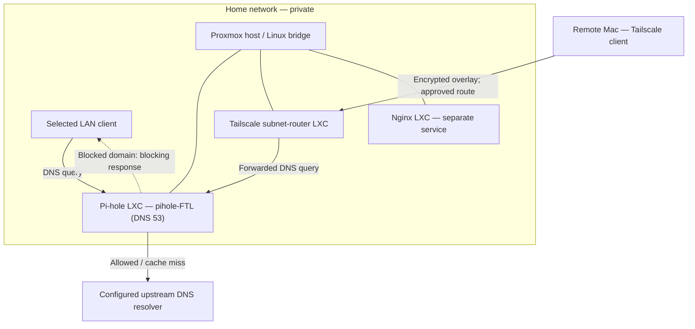
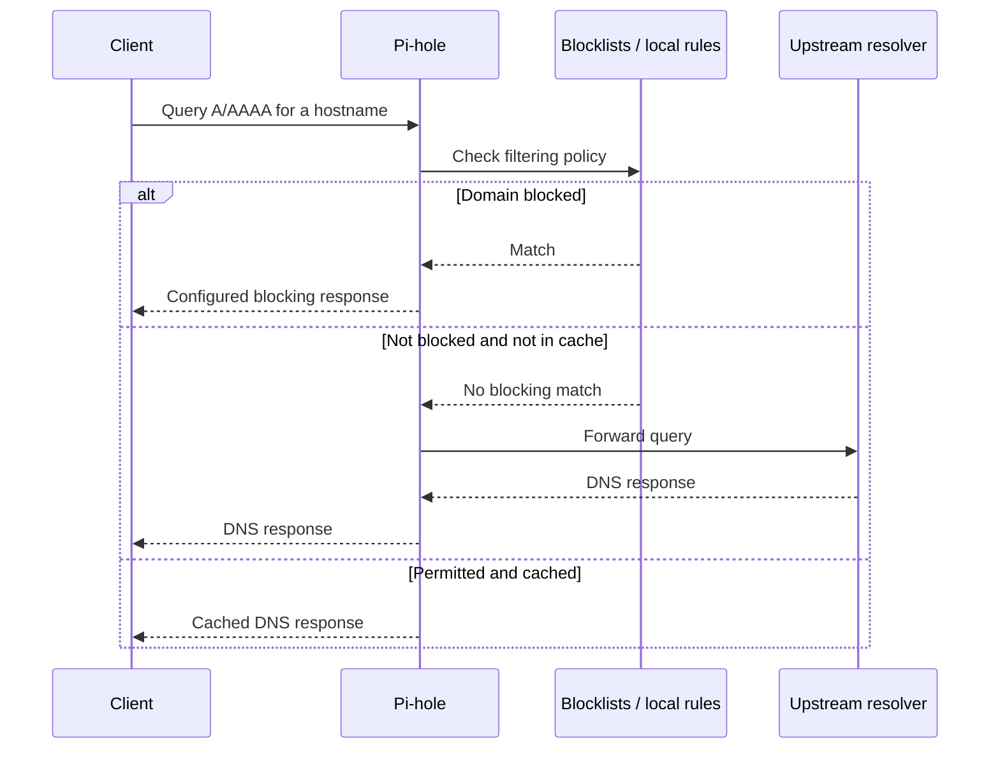

# 05 — Pi-hole: DNS, Filtering, and Network Security

[← Homelab index](README.md) · [← Tailscale](04-tailscale.md) · [Next: Nginx and SSH →](06-nginx-ssh.md)

> **Project:** Proxmox home lab · **Service:** Pi-hole in a Debian LXC container  
> **Status:** Deployed and directly tested on the LAN and through Tailscale  
> **Evidence convention:** **Verified** = observed during the build; **Configured** = reported setup choice; **Example** = a command or illustration to reproduce or check later; **Planned** = not yet implemented.  
> **Security:** Public examples use placeholders instead of actual host addresses, MAC addresses, credentials, or logs.

## 1. The problem I wanted to solve

I wanted **DNS-based filtering for selected devices**, both at home and when accessing my lab remotely. I did *not* want to replace the DNS settings for the entire household or place a new dependency in front of every device on the network.

My solution was to deploy **Pi-hole inside its own Debian 13 LXC container** on Proxmox. The container has a stable network address and a dedicated DNS service. My other services continue to run in their own containers, and my Tailscale subnet router provides a private path for approved remote clients to query Pi-hole.

**The engineering trade-off:** selective use is less disruptive while learning and troubleshooting; network-wide adoption would offer broader coverage but make more devices dependent on this DNS service.

## 2. What I built: architecture



> The diagram shows **logical flows**, not a claim that every household device uses Pi-hole. A direct DNS test from a client proves that the DNS service is reachable; it does **not** prove the client's default resolver is Pi-hole.

### Relevant components

| Component | Role | Why it matters |
|---|---|---|
| Debian LXC | Isolated lightweight Linux environment | Keeps DNS changes away from the hypervisor and other applications |
| `pihole-FTL` | Pi-hole DNS engine and supporting services | Answers, forwards, filters, and records DNS requests according to configuration |
| Gravity database | Consolidated rules from subscribed lists | Allows domain-level filtering and rule lookup |
| Upstream resolver | Resolves permitted external names | Pi-hole is not independently resolving every public name in this setup |
| Tailscale subnet router | Private path from authorized remote clients | Makes the Pi-hole destination reachable without a public DNS port-forward |
| Nginx container | Separate web-hosting service | Demonstrates service separation: web hosting is not the DNS engine |

## 3. DNS fundamentals: what happens before a webpage loads?

When a browser needs to reach `example.org`, it usually needs the site's IP address first. DNS translates the domain name to records a client can use.

**Common records:**

- `A`: IPv4 address; `AAAA`: IPv6 address.
- `CNAME`: aliases one DNS name to another (may introduce additional lookups).
- `MX`: email routing.
- `TXT`: arbitrary text, often used for domain verification, SPF, DKIM, and other policies.
- `NS`: authoritative name servers for a zone.
- `PTR`: reverse mapping from an IP address to a name.

A typical lookup involves a client, a recursive resolver, and potentially authoritative DNS servers. In this lab, Pi-hole is the **client-facing DNS filtering resolver**, while a configured upstream provider handles allowed public lookups Pi-hole cannot answer from its local data or cache.

### DNS request sequence



**Caching and TTL:** a Time to Live (TTL) tells clients/resolvers how long a DNS record may remain cached. A previously cached answer can make a configuration change appear delayed.

**DNS is not the webpage:** DNS answers tell the client where to connect. The actual website is typically retrieved separately over HTTP or HTTPS.

## 4. Pi-hole's filtering model

Pi-hole checks the queried domain against applicable rules. For a blocked `A` record, one possible response is **`0.0.0.0`** (a non-routable IPv4 destination). Depending on configuration and record type, blocked replies may differ. For an allowed domain, Pi-hole uses local data, a cache, or a configured upstream DNS resolver.

```text
Browser / application
        │ DNS request
        ▼
Pi-hole filtering resolver
        ├── Domain blocked? ──> configured blocking response
        └── Domain allowed? ──> cached answer / upstream resolver
```

This is **DNS sinkholing / filtering**, not packet inspection. Pi-hole is **not** itself an IDS, IPS, VPN, or full network firewall.

### What DNS filtering cannot guarantee

- It cannot remove every ad, especially first-party content sharing a domain with legitimate resources.
- It cannot inspect the contents of an encrypted HTTPS connection just because the domain was resolved through Pi-hole.
- Apps using a different DNS server or their own DNS-over-HTTPS (DoH) can bypass Pi-hole.
- IPv6 and alternative DNS paths matter: a client may resolve over a path you did not configure.
- A blocking response does not prove a domain is malicious; rules can generate false positives.

## 5. Deployment history — what I actually did

| Stage | Recorded action | Status |
|---|---|---|
| Provision | Created a dedicated Debian 13 LXC for DNS | **Verified** |
| Addressing | Assigned a stable address and created a router reservation | **Configured** |
| Installation | Installed Pi-hole inside the LXC and started `pihole-FTL` | **Verified** |
| Resolver | Selected Cloudflare's unfiltered upstream DNS | **Configured** |
| Filtering | Added additional privacy/security lists and ran a Gravity update | **Verified** |
| Management | Opened the administration page, reset the password, and signed in | **Verified** |
| Local test | Normal hostname resolved, while an advertising domain returned `0.0.0.0` | **Verified** |
| Remote test | Direct DNS queries reached Pi-hole through the approved Tailscale path | **Verified** |
| Whole-home DNS | Did **not** switch the router's DNS for all household devices | **Intentional decision** |

I ran Pi-hole as a **native installation in an LXC**, not inside Docker. The exact historical installer command, package versions, and all GUI choices were not captured in a complete terminal transcript; the table records the deployment facts I can substantiate, rather than pretending to be an installation transcript.

### Reproducing on a new system (reference, not a verbatim historical transcript)

1. Prepare a supported, updated Linux environment with a reachable **stable IP address**.
2. Confirm port **53/UDP** and **53/TCP** will be available to the DNS service. Protect management ports.
3. Follow the current [official Pi-hole installation instructions](https://docs.pi-hole.net/main/basic-install/).
4. Select the upstream resolver and list policy deliberately.
5. Keep DNS available only to intended clients; avoid exposing an open resolver to the internet.
6. Confirm the service, listening ports, query results, and remote path with separate checks.

Pi-hole's official prerequisites recognize Debian and recommend a stable IP address (including a DHCP reservation). See [Pi-hole prerequisites](https://docs.pi-hole.net/main/prerequisites/).

## 6. Validation: service, network, DNS, and policy are different checks

The following commands are **examples or repeatable checks**. Replace placeholders with your own internal addressing. They are read-only unless otherwise marked.

### Inside the Pi-hole container

```bash
# Does the systemd service currently run?
systemctl is-active pihole-FTL

# Pi-hole's own status check
pihole status

# Is DNS bound to a local socket? (requires appropriate permissions)
ss -lntup | grep ':53'

# Show recent service messages
journalctl -u pihole-FTL --no-pager -n 40

# Inspect current Pi-hole version; output may vary by release
pihole version
```

### From an authorized LAN or remote client

```bash
# Direct query: forces the request to this DNS server
nslookup example.org <PIHOLE_LAN_IP>
nslookup doubleclick.net <PIHOLE_LAN_IP>

# dig makes the server and DNS record type explicit
dig @<PIHOLE_LAN_IP> example.org A
dig @<PIHOLE_LAN_IP> doubleclick.net A
```

**What I observed in my project:** direct DNS queries returned a real IPv4 answer for an ordinary domain and a `0.0.0.0` blocking answer for `doubleclick.net`. I repeated tests while connected through Tailscale. Those results demonstrate direct reachability and policy behavior *at that moment*, not necessarily system-wide DNS enforcement on the client.

### Verify default DNS use separately

A direct command such as `nslookup example.org <PIHOLE_LAN_IP>` **bypasses normal resolver selection** for that query. To determine whether the operating system or browser actually uses Pi-hole by default, inspect the device DNS settings, query without the explicit server, and observe the matching request in Pi-hole's query log. Account for DNS caches, private relay features, and DoH-enabled browsers.

### Updating list data (changes state)

```bash
# Rebuild / update gravity from configured lists
pihole -g

# Display recent resolver requests for debugging; may show private hostnames
pihole tail
```

`pihole -g` is a management command, not a read-only check; it refreshes list data. Avoid publishing query logs without redaction.

## 7. Tailscale integration: remote DNS without opening port 53 publicly

The subnet-router LXC already provided an approved private path to selected LAN hosts. To query Pi-hole remotely:

1. The Mac joins the Tailscale network.
2. An allowed host route directs requests for the Pi-hole LAN IP toward the subnet router.
3. The subnet router forwards traffic toward the Pi-hole container.
4. Pi-hole answers DNS requests on port 53, if access and listening policy allow them.
5. Return traffic follows the configured routing/NAT path.

A successful encrypted Tailscale connection is not by itself proof that a particular hostname will resolve through Pi-hole. The DNS resolver must also be selected on the client or explicitly specified by the application/test. An optional future design is to configure a Tailscale DNS policy with appropriate access controls; **that broader configuration is not claimed as deployed here**.

## 8. Troubleshooting: isolate the failing layer

| Symptom | Likely layer | What to check |
|---|---|---|
| Pi-hole admin page loads but DNS queries time out | DNS process / firewall / port | `pihole status`, `ss`, UDP/TCP 53, container address |
| DNS works on LAN but not remotely | Tailscale route / ACL / forwarding | Is route approved, client using it, destination permitted? |
| `example.org` fails while Pi-hole is reachable | Upstream resolver / network / DNS config | Check upstream choices, internet route, FTL logs |
| Ads still appear | Policy / DNS selection / content model | Client's actual DNS server, DoH, cache, domain not listed, first-party ads |
| Legitimate site fails | Overblocking / upstream failures | Query log, allowlist, alternate resolver control test |
| DNS works until Pi-hole stops | Availability / single point of failure | DNS depends on Pi-hole; plan fallback carefully |
| Pi-hole returns an unexpected value | Record type / cache / settings | Compare `A` versus `AAAA`, TTL, blocking mode and upstream responses |
| DNS requests trigger loops | Resolver dependencies | Ensure Pi-hole's upstream is not pointing back to Pi-hole |

### A practical diagnostic order

```text
1. Is the Pi-hole container running?
2. Can the client reach the Pi-hole IP?
3. Is pihole-FTL healthy and bound to port 53?
4. Does a direct known-good DNS query work?
5. Does a direct blocked-domain test behave as expected?
6. Is the client actually configured to use Pi-hole?
7. If remote: is the Tailscale route and access policy correct?
```

Avoid changing the Proxmox host's bridge, default gateway, or global DNS while remotely administering it unless you have a rollback path.

## 9. Security, privacy, and operations

- **Least exposure:** no public router port-forward for DNS or the Pi-hole admin UI.
- **Separate services:** the DNS service stays in its own container rather than on the Proxmox host.
- **Scoped clients:** Pi-hole serves selected devices; the router has not been switched to enforce DNS for the entire household.
- **Protect the admin UI:** use strong credentials and restrict who can reach management ports.
- **Logging trade-off:** query logs aid troubleshooting but reveal domain-access patterns; use retention and privacy settings intentionally.
- **Availability trade-off:** if Pi-hole goes down, clients depending on it may lose hostname resolution while IP connectivity remains functional.
- **Backups and recovery:** back up configuration and rules, and document service restoration. Verified restore testing is a future improvement.
- **Updates:** check release notes before upgrades, especially after major Pi-hole changes.

**Security+ connections:** DNS records, network ports, secure remote access, least privilege, logging and monitoring, false positives, availability, and control validation.

## 10. Project result and interview story

**Problem:** I wanted ad/tracker-domain filtering without rewriting DNS for every device on the network.  
**Approach:** I deployed a dedicated Debian LXC with Pi-hole, a stable address, an upstream DNS resolver, and selected filtering lists.  
**Validation:** I checked both normal resolution and a deliberate blocking test, including over a separate Tailscale network path.  
**Outcome:** I gained a working, selectively used DNS service and a reproducible way to distinguish DNS, routing, service, and policy failures.  
**Limitation:** I have not claimed whole-network enforcement, guaranteed ad removal, or high availability.

### Example interview explanation

> “I deployed Pi-hole in a dedicated Debian LXC rather than installing DNS software directly on my Proxmox host. I configured an upstream resolver and filtering lists, then validated the result with direct DNS queries: a normal name returned an address, while a blocked advertising domain returned `0.0.0.0`. I also tested the same service over the private Tailscale subnet-router path. The key lesson was that DNS-service health, network reachability, filtering policy, and a client's default DNS configuration are four distinct things to verify.”

## 11. Evidence to add next

- [ ] Redacted Pi-hole dashboard image (no client addresses, private domains, query history, tokens, or login details).
- [ ] Sanitized `pihole status` and version output.
- [ ] Redacted proof of a normal DNS response and a blocked response from an approved client.
- [ ] A description of how the Pi-hole LXC's RAM and storage limits were chosen after checking actual utilization.
- [ ] Document whether default DNS is enabled on any client, versus only direct per-query testing.
- [ ] Record backup/export method and run a restore test in a disposable environment.

## 12. References

- [Pi-hole installation and prerequisites](https://docs.pi-hole.net/main/prerequisites/)
- [Pi-hole CLI commands](https://docs.pi-hole.net/main/pihole-command/)
- [Pi-hole FTL configuration (upstream, listening, and logging)](https://docs.pi-hole.net/ftldns/configfile/)
- [Pi-hole Gravity database](https://docs.pi-hole.net/database/gravity/)
- [Tailscale subnet routers](https://tailscale.com/docs/features/subnet-routers)

[← Homelab index](README.md) · [← Tailscale](04-tailscale.md) · [Next: Nginx and SSH →](06-nginx-ssh.md)
