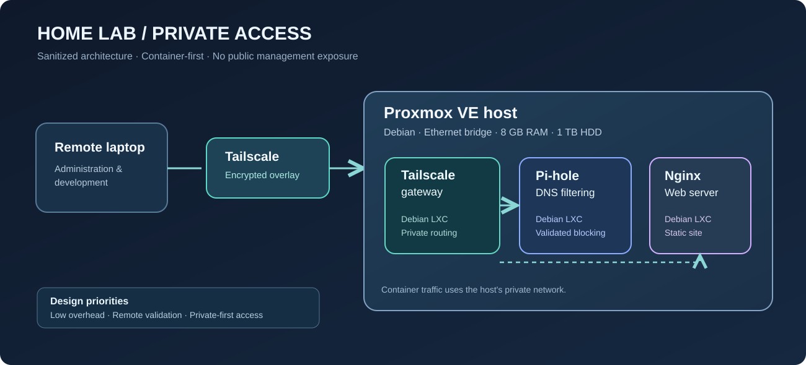

# Proxmox Home Lab — Build Log and Technical Guide

> **Scope:** A documented home-lab project, not a production infrastructure blueprint.  
> **Status:** Proxmox, Tailscale, Pi-hole, and Nginx deployed; continuing development.  
> **Public version:** Addresses and device identifiers are removed or represented with illustrative placeholders.  
> **Evidence convention:** **Verified** means directly observed during the build. **Documented choice** means a configuration decision. **Example** means a reproducible command or conceptual illustration, not proof it was run. **Planned** means not deployed yet.

## The problem I wanted to solve

I wanted a small, always-on technical environment to practice Linux administration, networking, web hosting, and security fundamentals. Instead of buying server hardware, I repurposed an older HP Pavilion desktop (AMD A10-7800, 8 GB RAM, 1 TB HDD). The RAM ceiling influenced the architecture: I used **Proxmox VE and Debian-based LXC containers** rather than separate full operating-system VMs for every service.

## Build sequence

| Stage | What changed | What I learned |
|---|---|---|
| 1 | Prepared BIOS/UEFI and installation USB | Firmware, boot mode, and installer compatibility |
| 2 | Installed Debian 13, then Proxmox VE 9 packages | Hypervisor vs. operating system; alternate installation method |
| 3 | Configured Ethernet and `vmbr0` with stable management addressing | Linux bridges, routing, IP addressing, service reachability |
| 4 | Created a lightweight Tailscale gateway LXC | VPN overlay, virtual TUN interfaces, forwarding, subnet routes |
| 5 | Deployed Pi-hole as a separate DNS-service LXC | DNS resolution, filtering, upstream resolvers, testing |
| 6 | Deployed an Nginx web-server LXC with SSH access | HTTP, Linux permissions, least privilege, remote development |
| 7 | Verified services locally and from a separate network | Isolation of network, service, DNS, and client-side failures |

## Guide chapters

1. [Host preparation and Proxmox installation](01-host-installation.md)
2. [Network addressing, `eno1`, `vmbr0`, and routing](02-networking.md)
3. [LXC containers, virtualization, and resource decisions](03-containers-resources.md)
4. [Remote access with Tailscale](04-tailscale.md)
5. [DNS filtering with Pi-hole](05-pihole.md)
6. [Static web hosting and SSH with Nginx](06-nginx-ssh.md)
7. [Validation, troubleshooting, and lessons learned](07-validation-troubleshooting.md)
8. [Security boundaries, next steps, and references](08-security-roadmap.md)
9. [Template for documenting every new service](09-service-deployment-template.md)

## Architecture



**Traffic paths, conceptually:**

```text
Remote laptop (Tailscale client)
       │ encrypted overlay tunnel
       ▼
Tailscale subnet-router LXC ── forward only approved private destinations
       │
       ├── Proxmox web management (HTTPS, TCP 8006)
       ├── Pi-hole DNS service (UDP/TCP 53)
       └── Web server (HTTP, TCP 80) — reachability depends on route approval

Home router ── Ethernet ── Proxmox host eno1 / vmbr0
                               ├── LXC: Tailscale
                               ├── LXC: Pi-hole
                               └── LXC: Nginx
```

> The original subnet-router configuration was verified for selected host and Pi-hole destinations. Do not assume the webserver's remote route was approved without checking. This diagram shows architecture, not a claim about every route.

## Measurable evidence already observed

- **Verified:** remote administration from an outside Wi-Fi network, not just the home LAN.
- **Verified:** a normal DNS query returned an address, while a direct query for an advertising domain returned `0.0.0.0` via Pi-hole.
- **Verified:** an Nginx page was served from the web-server LXC and SSH terminal access worked.
- **Partly unresolved:** VS Code Remote-SSH encountered a `No route to host` error in a specific test, despite successful terminal SSH. Treat those as separate observations until retested.

## What this demonstrates

- Designing around actual **CPU, RAM, disk and network** constraints
- Configuring and administering a Debian-based hypervisor and LXC guests
- Explaining **layer 2 vs. layer 3**, DNS, service ports, routing, encryption, and access control
- Troubleshooting by checking one layer at a time and validating results with observable tests
- Keeping management services private and documenting what is **not yet production-ready**

For the larger portfolio, see [Proxmox Home Lab overview](../../projects/homelab.md).
