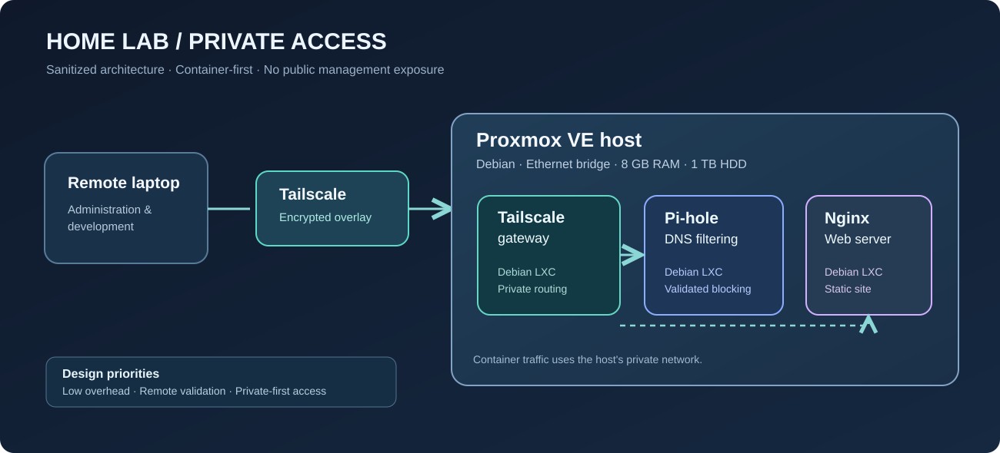
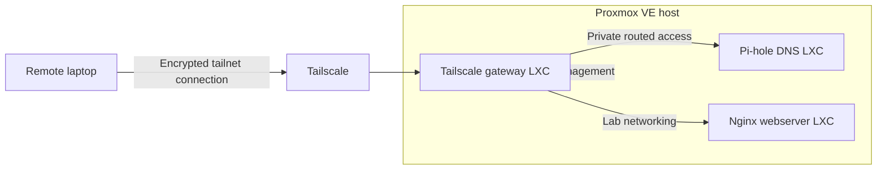

# 🖥️ Proxmox Home Lab

> **Status:** operational foundation; continuing development.  
> **Focus:** virtualization, Linux administration, private networking, DNS, and self-hosting.

[← Back to portfolio](../README.md)

## Summary

I repurposed an HP Pavilion desktop into a container-focused home lab. The lab serves as a practical environment for learning service deployment, network design, remote administration, troubleshooting, and system resource management.

### Host constraints

| Component | Configuration |
|---|---|
| Hardware | HP Pavilion 550-127c |
| Processor | AMD A10-7800 |
| Memory | 8 GB RAM |
| Storage | 1 TB HDD |
| Virtualization host | Proxmox VE 9.2 on Debian 13 |
| Main networking | Wired Ethernet with a Linux bridge |

I intentionally favor **LXC containers over full virtual machines** when an application does not need its own kernel. This lowers per-service overhead on limited hardware, though it also means kernel isolation and compatibility differ from a full VM.

## Complete build and interview-friendly technical reference

The installation and service deployment sequence is documented in the [Proxmox Home Lab Build Guide](../docs/homelab/README.md), including networking, containers, Tailscale, Pi-hole, Nginx, validation, and security trade-offs. Each chapter distinguishes verified behavior from illustrative commands and future plans.

## Architecture

*The diagram is conceptual. Internal addresses, keys, and device identifiers are intentionally excluded.*

## Services deployed

| Service | Purpose | Evidence of functionality |
|---|---|---|
| **Tailscale gateway** | Private administration and access to selected internal destinations | Verified remote connection from outside the home network |
| **Pi-hole** | DNS-based blocking for selected devices | Queried the DNS server directly and confirmed a known ad domain returned a blocked result |
| **Nginx web server** | Host static content for ongoing web development | Reached the default page and edited site files through SSH |

### Implementation decisions

1. **Static host and service addressing** to simplify troubleshooting and service discovery.
2. **Wired networking** on the hypervisor, with the Wi-Fi interface disabled.
3. **Unprivileged LXC for Tailscale** with the required network tunneling support.
4. **SSH key authentication** for development access.
5. **Private-first deployment:** management endpoints are not intentionally published on the public web.

## Troubleshooting and validation

- Checked DNS resolution and blocking using command-line DNS queries, both locally and across the private network.
- Validated remote access from a separate network, rather than testing only while connected to the home LAN.
- Diagnosed an IDE SSH connectivity issue separately from terminal SSH success—helpful for isolating client configuration from server availability.
- Worked through host networking, storage configuration, service startup, and Linux permissions.

## What this demonstrates

**Linux administration · Layer 3 networking · Service deployment · Access control · DNS debugging · Resource trade-offs · Technical documentation**

## Roadmap (not yet claimed as deployed)

- Add monitoring and metrics for host, containers, and network services.
- Introduce version-controlled deployment/configuration examples with secrets excluded.
- Evaluate a dedicated IDS/IPS or SIEM lab in the context of available memory.
- Publish a small application through a carefully designed reverse-proxy and TLS setup once security controls are ready.

## Screenshots to add

1. Proxmox container overview with unique addresses and identifiers hidden.
2. Pi-hole dashboard with potentially identifying information redacted.
3. Nginx landing page and sanitized terminal validation output.

[Publishing guidance](../docs/publishing-checklist.md)
