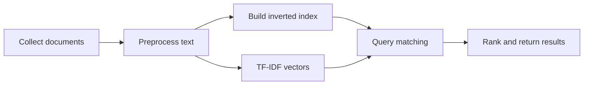

# 📚 Information Retrieval & Search

> **Status:** academic project work; update with implementation links and evaluation evidence.

[← Back to portfolio](../README.md)

## Goal

Explore the components of a search engine: collection, tokenization, indexing, retrieval, ranking, and evaluation.

## Topics implemented or studied in coursework

- Web crawling and document collection.
- **Inverted indexes** for efficient lookup.
- **TF-IDF** features for term and document relevance.
- **PageRank** to reason about link structure.
- Classification experiments involving **support vector machines and neural networks**.

## Evidence to add

| Artifact | What it demonstrates |
|---|---|
| Architecture diagram | How indexing, retrieval, and ranking fit together |
| Sample query output | Functional search behavior |
| Evaluation table | Retrieval precision/recall or latency, when measured |
| Source code | Reproducibility and engineering quality |

**Skills:** Python, text processing, data structures, indexing, ranking, machine learning.
