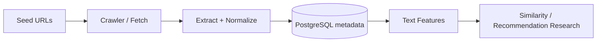

# 🔎 Tor / I2P Link Discovery & Recommendation Research

> **Status:** research/development.  
> **Focus:** crawling, data engineering, information retrieval, and link analysis.

[← Back to portfolio](../README.md)

## Problem

Content discovery in privacy-preserving networks creates different engineering challenges from conventional web indexing: service availability varies, address formats differ, encodings can be inconsistent, and repeated or inaccessible pages complicate data quality.

## Technical approach

- Built **Python and Selenium-based crawling workflows** configured to access Tor and I2P services in a research context.
- Extracted, normalized, and deduplicated candidate links, handling `.onion` and `.i2p` address patterns.
- Stored discovered-site metadata and crawl state in **PostgreSQL** to support iterative processing and queries.
- Explored features for content similarity and ranking, including **TF-IDF, document embeddings, and dimensionality reduction**.
- Investigated ingestion reliability issues involving timeouts, inconsistent text encoding, URL sanitization, and database resource limits.

## Simplified pipeline

## Engineering lessons

- Separate network failures from parsing failures so retries are targeted and logs are useful.
- Canonicalize and deduplicate data before computing counts or deriving link features.
- Use bounded queues, timeouts, and memory-aware processing in fragile environments.
- Keep collected content and host-specific routing information out of public demos unless publication is clearly appropriate and authorized.

## Tools & concepts

Python · Selenium · PostgreSQL · Tor · I2P · HTML parsing · Regular expressions · TF-IDF · Embeddings · Deduplication

## Public-repo scope

This page is a high-level research description. It **does not publish live target lists, raw crawled pages, credentials, or sensitive datasets**. Reproducible demonstrations should use safe public samples or synthetic data.

## Potential evidence to add

- Sanitized schema diagram and crawler pseudocode.
- Dataset statistics after reconfirming the collection method and exact counts.
- Experiments comparing lexical and embedding-based retrieval on a safe evaluation dataset.
